# How Much Accuracy Is Worth the Additional Computing Cost?

> **Status note (2026-11-06):** This is the earlier pilot report and has not been fully rewritten after the expanded runs. Use [FINAL_RESEARCH_REPORT.md](FINAL_RESEARCH_REPORT.md), [LLM_EVALUATION_REPORT.md](LLM_EVALUATION_REPORT.md), and [STATISTICAL_ANALYSIS_REPORT.md](STATISTICAL_ANALYSIS_REPORT.md) for updated experiment evidence. The observations below remain historical pilot analysis.

> **Superseded status correction (2026-11-07):** The historical pilot text below reflects the state before subsequent runs. Actual sklearn LabelPropagation now has a separate three-seed iteration sweep and converges at tolerance 1e-3; the earlier LabelSpreading result remains a distinct historical pilot. Mean Teacher, FixMatch and MixMatch now have three-seed curves across five label fractions through epoch 3. Consult `FINAL_RESEARCH_REPORT.md` and `REMAINING_WORK.md` for current evidence and limitations.

**Research status: extended feasibility pilots recorded; requested full budget/seed sweeps and literature synthesis remain incomplete.** This report separates locally measured pilots, literature-reported results, and project calculations. The 20 conventional registry entries have one-seed feasibility records, although the requested Label Propagation entry was evaluated with the related LabelSpreading algorithm and the ViT-Tiny entry uses a compact custom architecture. Six of 15 LLM configurations have local WikiText-2 prefix scores, and a short Pythia-70M checkpoint trajectory has been measured. These do not complete the requested full study.

## Abstract

This study asks whether additional computational expenditure improves AI performance and whether marginal gains diminish at larger budgets. The supplied proposal specifies progressive budgets, timed training, and comparison with published evidence. We implemented one-seed feasibility evaluations for 20 Fashion-MNIST and RL model entries, six local small-LLM configurations, and eight Pythia-70M checkpoints. The local runs are exploratory and below the requested schedules. Chinchilla, PaLM, and LLaMA literature results provide contextual evidence, not reproductions or a cross-paradigm efficiency ranking.

## 1. Introduction and motivation

The proposal's central question is: **How does AI model performance change when computational expenditure increases, and does marginal improvement diminish at higher computational budgets?** Accuracy-only comparisons conceal both the cost of obtaining a score and the cost of serving the resulting model. This project therefore treats training, evaluation, and inference costs separately and retains metric-specific units.

The proposal notes compute time, energy, and infrastructure as relevant costs, while identifying hardware differences and incomplete literature accounting as limitations. The expanded prompt adds token-level LLM training dynamics and broader model paradigms. These additions do not change the research question; they broaden the evidence base.

## 2. Research questions

The study will examine the 15 questions in the project brief, especially: whether more compute always helps; whether marginal gains decline; how epochs, tokens, and environment interactions change generalization; and whether smaller, longer-trained language models can outperform larger, undertrained models at comparable compute. Classification accuracy, clustering scores, RL returns, and language-model perplexity will be analyzed within their own paradigms. No direct raw-score ranking across these metrics is valid.

## 3. Literature review and research gap

Kaplan et al. report empirical power-law scaling of language-model cross-entropy with model size, dataset size, and training compute, motivating analysis of continuous scaling curves [original paper](https://arxiv.org/abs/2001.08361). Hoffmann et al. investigate compute-optimal allocation and report that Chinchilla (70B parameters, 1.4T tokens) shares a training-compute budget with Gopher while using four times more data; they report Chinchilla outperforming Gopher, GPT-3 and other large models across many downstream tasks [original paper](https://arxiv.org/abs/2203.15556). This supports the hypothesis that parameter count alone is not an adequate efficiency measure.

Pythia offers 16 model sizes from 70M to 12B trained on the same data in the same order, with 154 public checkpoints for each model, allowing trajectory analysis rather than endpoint-only comparisons [original paper](https://arxiv.org/abs/2304.01373). Brown et al. report GPT-3's 300B-token mixture with dataset-specific passes ranging from below one to multiple repetitions, so an undifferentiated “epoch” is not appropriate [original paper](https://arxiv.org/abs/2005.14165). PaLM reports compute for 8B, 62B, and 540B variants; its Table 22 gives 2.56e24 train FLOPs for PaLM-540B at 780B tokens, including rematerialization, and 3.08e23 for PaLM-62B at 795B tokens [original paper](https://arxiv.org/abs/2204.02311).

The gap is practical: report marginal performance improvement beside incremental cost under clearly stated protocols. The original proposal frames this for a small number of lightweight models; the expanded scope makes clear that the experimental scale must be tiered and resource-constrained.

## 4. Methodology

### 4.1 Conventional AI

The registry spans 20 requested methods: MLP, LeNet-style CNN, ResNet-18, ViT-Tiny, Random Forest; K-Means, Gaussian Mixture, DBSCAN, autoencoder, variational autoencoder; pseudo-labeling, Mean Teacher, FixMatch, MixMatch, Label Propagation; DQN, Double DQN, A2C, PPO, and SAC. Each algorithm must use a suitable task and its own budget unit. Epoch schedules apply to iterative supervised methods; clustering uses its own iterations/initializations; RL uses environment interactions and gradient updates. Fashion-MNIST is the initial image dataset; RL uses Gymnasium environments appropriate to discrete or continuous action spaces. Fixed splits, multiple seeds, and separate train/validation/test measurements are specified in [experiment design](EXPERIMENT_DESIGN.md).

### 4.2 LLM evaluation

The requested local target is eight Pythia sizes, four GPT-2 sizes, and three OPT sizes. Evaluation must be sequential, use a reproducible harness and fixed prompts/task versions, and record loading/evaluation time and memory. Checkpoint selection uses ten trajectory quantiles rather than all 154 points. Tokens and steps are primary training-progress axes. Pretraining epochs are only reported when dataset passes are defined. No original pretraining cost is attributed to downloading/evaluating a checkpoint. The detailed protocol is in [LLM_RESEARCH_DESIGN.md](LLM_RESEARCH_DESIGN.md).

### 4.3 Literature extraction

The initial ledger has 15 model configurations: GPT-3, Gopher, Chinchilla, PaLM-540B, six OPT sizes, four LLaMA sizes, and BLOOM. Pythia is an additional required family for checkpoint analysis, not part of these 15 rows. CSV columns preserve numeric values and units separately, record sources/locators, and leave unavailable fields empty. The Pythia checkpoint source and the required papers are listed in [literature_sources.md](results/literature/literature_sources.md). Some source fields (especially OPT's completed tokens for each size, and missing infrastructure details) remain unpopulated unless explicitly reported.

## 5. Results

### 5.1 Local experiments

Dependencies were installed into the project `.venv`. Fashion-MNIST and public Pythia/WikiText-2 files were downloaded. The runs below are one-seed exploratory pilots. The MLP and pseudo-labeling pilot evaluated the official test split after every epoch to inspect trajectory; those repeated test looks make these curves exploratory rather than confirmatory. The full experiment design separates validation progression from final test evaluation. No confidence intervals or statistical significance are claimed.

| Paradigm / model | Budget | Measured outcome | Cumulative training time | Notes |
|---|---:|---:|---:|---|
| Supervised MLP | 1, 2, 3 epochs | test accuracy 0.7831, 0.7891, 0.8202 | 0.477, 0.937, 1.370 s | 12,000-example train subset; 101,770 parameters; one seed |
| Unsupervised K-Means | 17 iterations | adjusted Rand index 0.3471 | 0.151 s fit + 0.0016 s score | one initialization; 2,500-example subset; one budget only |
| Pseudo-labeling, threshold 0.95 | 1, 2, 3 epochs | test accuracy 0.5747, 0.6326, 0.6257 | 0.047, 0.093, 0.137 s | 600 labeled examples (5%); added zero pseudo labels |
| Pseudo-labeling, threshold 0.80 | 1, 2, 3 epochs | test accuracy 0.5747, 0.6326, 0.6257 | 0.049, 0.099, 0.146 s | same seed and initialization; added 262 pseudo labels after epoch 3; score fell 0.0069 from epoch 2 |
| DQN, CartPole-v1 | 1,000, 2,500, 5,000 environment steps | mean return over 5 evaluation episodes: 11.4, 155.6, 226.0 | 0.456, 1.395, 2.851 s | one seed; separate evaluation environment; evaluation time separately recorded |

The matched pseudo-label runs show no score change through epoch 2 when the thresholds yielded no pseudo-labels. At epoch 3, the 0.80 threshold labeled 262 additional examples, yet this single-seed test score matched the 0.95 run and had already declined from its epoch-2 value. This is an inconclusive pilot, not evidence that pseudo-labeling is harmful in general. In the corrected DQN run, return gains were 144.2 points over the first 1,500 interactions and then 70.4 points over the next 2,500, a smaller gain per step. The curve is consistent with early diminishing returns in this run, but five evaluation episodes and one seed are too few to infer a stable saturation point.

Earlier pseudo-label, K-Means, and DQN exploratory passes are preserved in the raw CSV under distinct run IDs and marked superseded; they are omitted from the summary table because the initialization sequence was not reset for the first pseudo-label pass, K-Means scoring time was not measured in its first pass, and DQN initially reused its training environment during evaluation.

#### LLM pilot

The local Pythia-70M checkpoint (70,426,624 parameters) loaded from cache in 0.53 seconds. The exact `step143000` revision corresponds to the model card's main checkpoint; it represents 143,000 training steps and 299,892,736,000 training tokens. A single truncated 2,048-token sequence from the WikiText-2 raw test split produced loss 3.6122 and perplexity 37.05 in 3.93 seconds, with peak process working set 1.74 GB. This short excerpt is a smoke evaluation, not a standardized WikiText-103 or harness result; it cannot be compared directly with published perplexities. The step/token counts are source-reported metadata, not locally measured training. Loading and inference costs do not represent original pretraining cost. [Pythia-70M model card](https://huggingface.co/EleutherAI/pythia-70m)

### 5.2 Pilot figures

Each figure below shows one compatible metric series. Curves are descriptive and single-seed; the literature scatter is a paper-reported comparison, not a local evaluation.

**Supervised MLP: test accuracy against cumulative train time.**

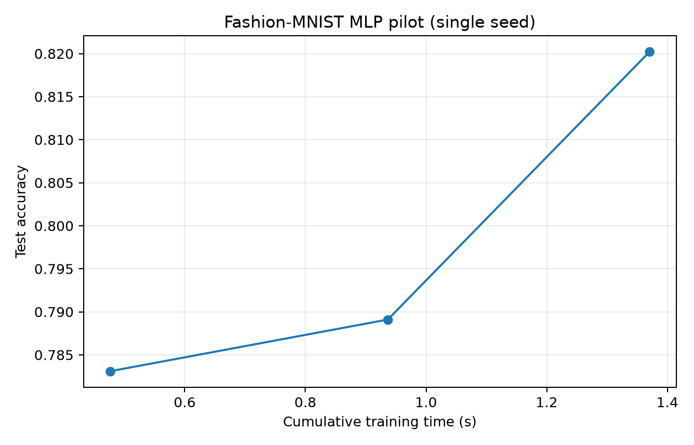

**Semi-supervised pseudo-labeling: threshold sensitivity.**

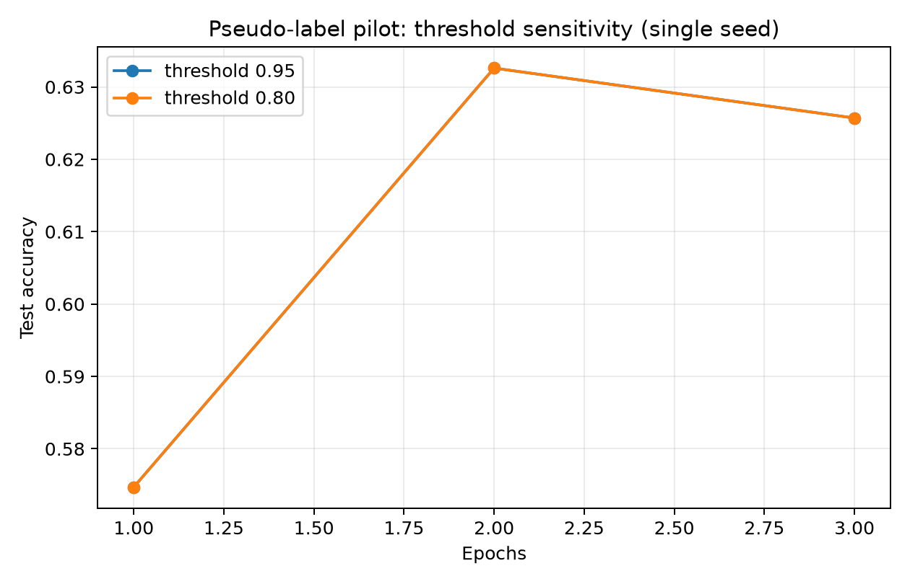

**Reinforcement learning: episodic return against interaction budget and train time.**

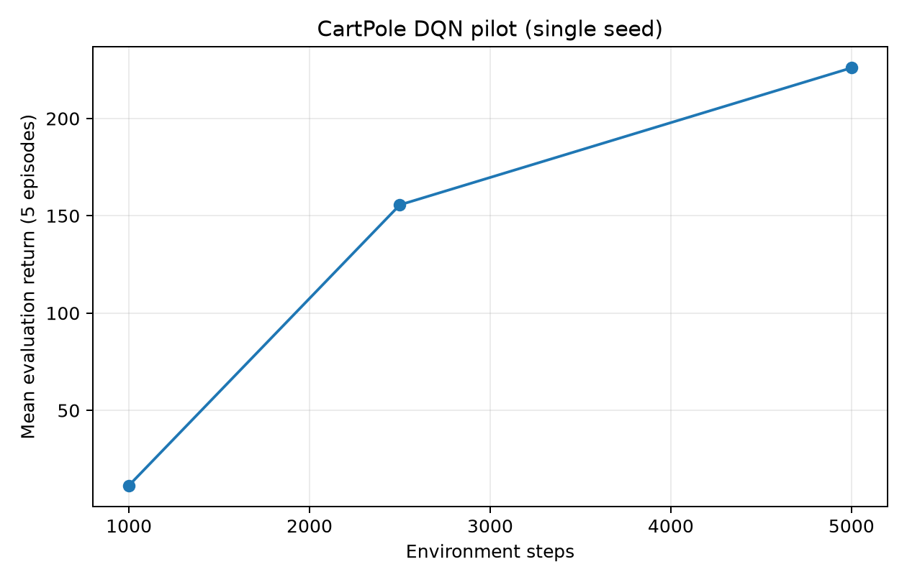

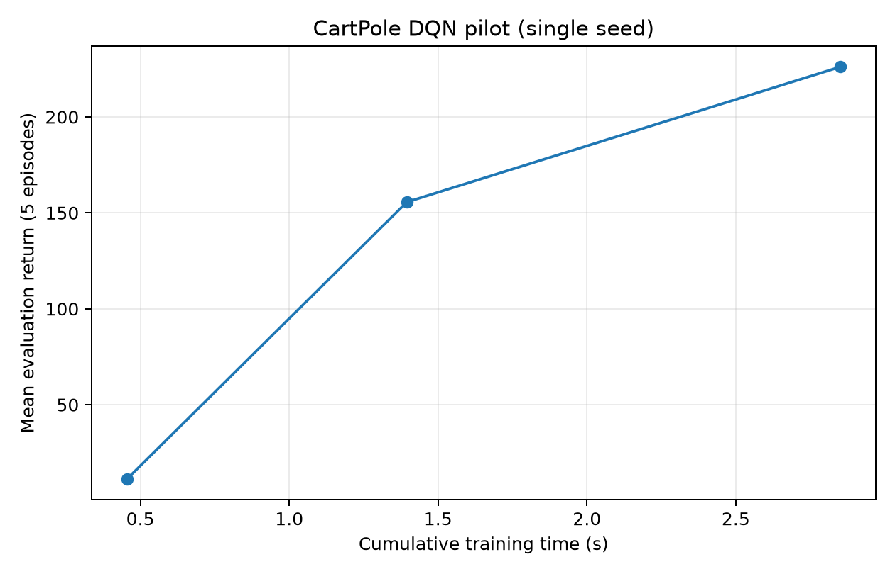

**Unsupervised clustering: single K-Means point.** There is no multi-budget curve yet.

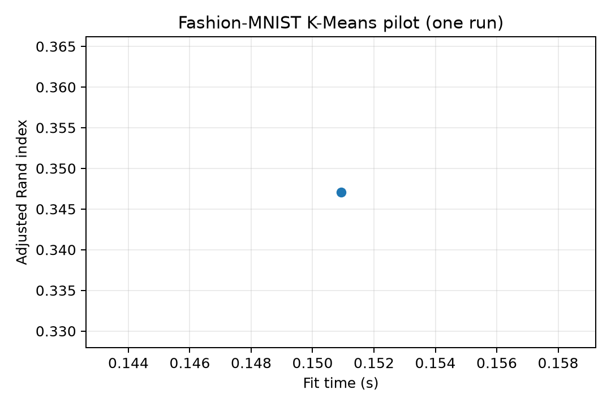

### 5.3 Published evidence

The CSV records 15 configurations. Its HellaSwag values come from LLaMA Table 3's reported zero-shot comparison: 76.1% for LLaMA-7B, 79.2% for LLaMA-13B, 82.8% for LLaMA-33B, and 84.2% for LLaMA-65B, alongside GPT-3 175B at 78.9%, Gopher 280B at 79.2%, Chinchilla 70B at 80.8%, and PaLM 540B at 83.4%. These are one paper's cross-model summary, not common-condition or compute-matched causal evidence. LLaMA Table 2 reports 1.0T tokens for the 6.7B/13.0B variants and 1.4T for 32.5B/65.2B; the authors estimate about 21 days for 65B on 2,048 A100 GPUs at the stated throughput [LLaMA paper](https://arxiv.org/abs/2302.13971).

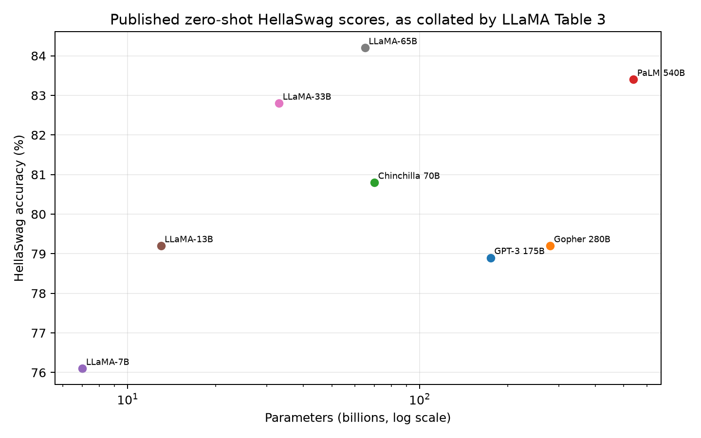

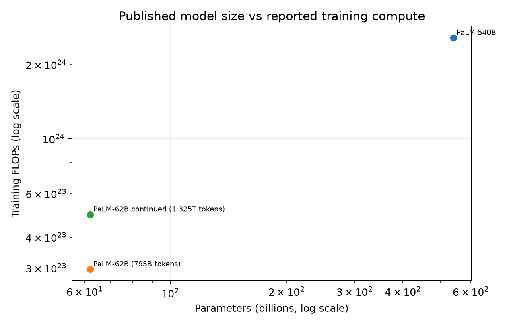

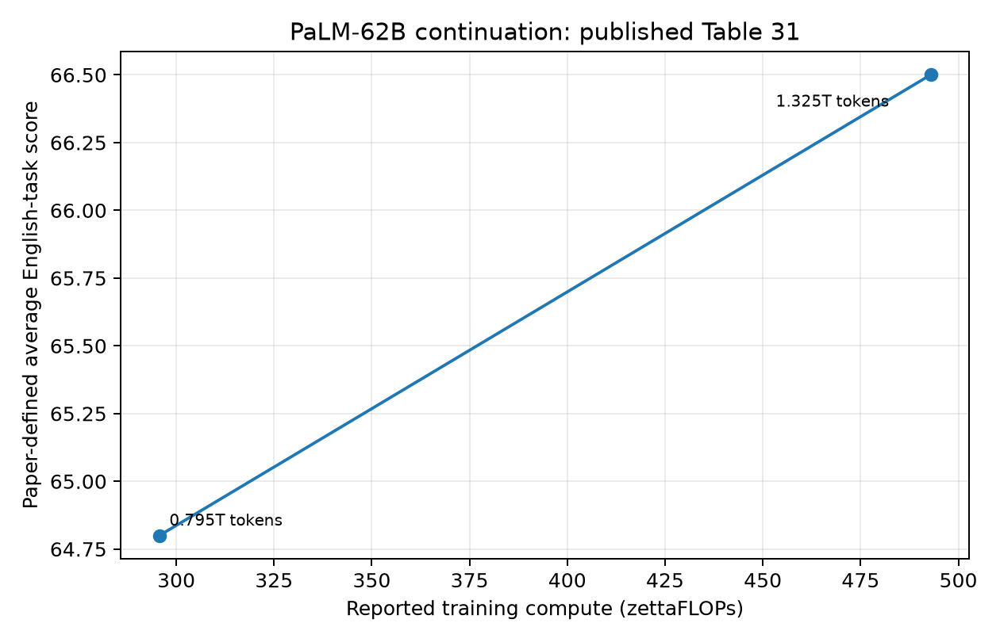

PaLM's Appendix Table 22 reports compute usage for its 8B, 62B, and 540B models. PaLM-540B used 2.56e24 training FLOPs at 780B tokens. Appendix Table 31 gives a within-family continuation pair for PaLM-62B: from 795B to 1,325B tokens and from 295.7 to 492.9 zettaFLOPs, its paper-defined average English-task score moves from 64.8 to 66.5. This is one reported interval, not enough to establish a general saturation curve. The figures show the two-point progression; hardware time is not inferred from the FLOPs.

BLOOM's project paper identifies a 176B model and ROOTS as the training corpus. A companion project carbon-accounting paper reports 1,082,990 A100 GPU-hours and 433,196 kWh; these are retained in their own CSV fields. The BLOOM paper reports about 341B ROOTS tokens and an additional 25B tokens from repeated data; the CSV labels their sum, 366B processed tokens, as calculated. OPT reports a roughly 180B-token corpus and training schedule with decay over 300B tokens; corpus size is not equated with processed training tokens.

### 5.5 Expanded feasibility runs and hardware-aware execution

After the initial pilots, all 20 conventional registry entries received an implementation and at least one saved evaluation record; however, Label Propagation is represented by a LabelSpreading proxy and ViT-Tiny by a custom compact variant, so those requested specifications were not reproduced exactly. The additional neural runs used DirectML on the Radeon 860M; the scikit-learn models and all RL algorithms ran on CPU. These remain pilots: one seed, a 2,500-image Fashion-MNIST subset for the vision tasks, and a single optimization pass (100 trees for Random Forest; one fit/iteration run for the classical estimators). RL algorithms used 5,000 environment interactions and five evaluation episodes. The rows are in `results/raw/full_suite_results.csv`; earlier records remain in `results/raw/experiment_results.csv`.

| Model | Pilot evaluation metric | Observed value | Budget |
|---|---|---:|---:|
| MLP | Held-out accuracy | 0.612 | 1 epoch (16 batches) |
| CNN / LeNet | Held-out accuracy | 0.638 | 1 epoch (16 batches) |
| ResNet-18 | Held-out accuracy | 0.424 | 1 epoch (16 batches) |
| Compact ViT-Tiny-style model | Held-out accuracy | 0.492 | 1 epoch (16 batches); custom 3-layer, 96-wide encoder |
| Random Forest | Test accuracy | 0.834 | 100 trees |
| K-Means | Adjusted Rand index | 0.367 | 20 iterations |
| Gaussian Mixture Model | Adjusted Rand index | 0.312 | 19 EM iterations |
| DBSCAN | Adjusted Rand index | 0.000 | One fit |
| Autoencoder | Held-out reconstruction MSE | 0.0880 | 1 epoch (16 batches) |
| Variational Autoencoder | Held-out reconstruction MSE | 0.1156 | 1 epoch (16 batches) |
| Pseudo-Labeling | Held-out accuracy | 0.352 | 1 warm-start + 1 SSL epoch |
| Mean Teacher | Held-out accuracy | 0.324 | 1 warm-start + 1 SSL epoch |
| FixMatch | Held-out accuracy | 0.352 | 1 warm-start + 1 SSL epoch |
| MixMatch | Held-out accuracy | 0.498 | 1 warm-start + 1 SSL epoch |
| LabelSpreading proxy for requested Label Propagation | Transductive test accuracy | 0.700 | 7 graph iterations |
| DQN | Mean return over five episodes | 10.0 | 5,000 environment steps |
| Double DQN | Mean return over five episodes | 49.0 | 5,000 environment steps |
| A2C | Mean return over five episodes | 286.0 | 5,000 environment steps |
| PPO | Mean return over five episodes | 168.4 | 5,000 environment steps |
| SAC | Mean return over five episodes | -377.8 | 5,000 environment steps |

The reported accuracy values use a held-out split drawn from the 2,500-image subset; the graph method is explicitly transductive. The run used scikit-learn LabelSpreading, which is related to but distinct from the requested Label Propagation algorithm. Likewise, the ViT entry is a compact custom 3-layer, 96-wide transformer, not a standard ViT-Tiny configuration. These single-seed endpoint values are not fair model rankings: architectures, optimization steps, and in one case evaluation protocol differ.

The DirectML neural batch covered MLP, LeNet, ResNet-18, ViT-Tiny, Autoencoder, VAE, Pseudo-Labeling, Mean Teacher, FixMatch, and MixMatch. The SSL experiments used a fixed 10% labeled split and one warm-start epoch plus one SSL epoch. FixMatch and MixMatch are compact feasibility implementations, not full benchmark reproductions. PyTorch DirectML warned that Adam's `lerp` operation fell back to CPU. Therefore, the backend field reports DirectML selection, but these are not fully GPU-resident operator profiles.

The same random MLP and input batch were used for a short CPU/DirectML microbenchmark. CPU reached 171,088 measured samples/s and 344.3 SGD steps/s; DirectML reached 215,569 samples/s and 295.3 steps/s. Median batch latency was 0.197 ms on CPU and 0.500 ms on DirectML; DirectML model load/copy time was 0.240 s versus 0.0011 s on CPU. This is a small microbenchmark and not evidence that one device is generally faster. GPU utilization and DirectML VRAM were not isolated.

The detected NPU is the integrated XDNA 2 NPU in Ryzen AI 7 350; its device driver is 32.0.203.314, but the Ryzen AI/VitisAI or Windows ML provider is not installed in the project environment, so no NPU benchmark is reported. AMD's current ROCm 7.14.1 matrix lists this Ryzen AI 7 350/Radeon 860M for Windows 11 25H2, but requires Adrenalin 26.6.4 or OEM driver 26.10.28. The installed display driver is dated 2025-10-30 and does not meet that listed driver requirement, so I did not replace it or trigger a system reboot. DirectML was the working GPU path used for these runs [AMD ROCm 7.14.1 compatibility matrix](https://rocm.docs.amd.com/en/docs-7.14.1/compatibility/compatibility-matrix.html), [Microsoft DirectML/PyTorch guidance](https://learn.microsoft.com/en-us/windows/ai/directml/pytorch-windows), [AMD Ryzen AI provider setup](https://ryzenai.docs.amd.com/projects/WinML/en/latest/installation.html).

The LLM extension evaluated six configurations locally on CPU using one 2,048-token prefix from WikiText-2 raw test (capped at 1,024 tokens for GPT-2 Small): Pythia-70M, 160M, and 410M; GPT-2 Small; OPT-125M and 350M. Pythia-70M was evaluated at eight training steps (0, 1K, 5K, 10K, 20K, 50K, 100K, and 143K; the 143K score reuses the earlier exact-checkpoint evaluation). Pythia-160M and 410M were additionally evaluated at steps 0, 10K, and 143K. Their step-143K WikiText-2 prefix losses were 3.0102 and 2.5387, respectively; these are same-protocol single-sequence observations, not broad benchmark comparisons. For Pythia-70M, loss rises from 3.47 at 50K to 3.56 at 100K on this single slice. GPT-2 Medium's weight download stalled before loading; five larger Pythia models, GPT-2 Large/XL, and OPT-1.3B were marked resource-limited before weight loading. None has a local score. Exact records and retry statuses are in `results/llm/expanded_llm_evaluations.csv`.

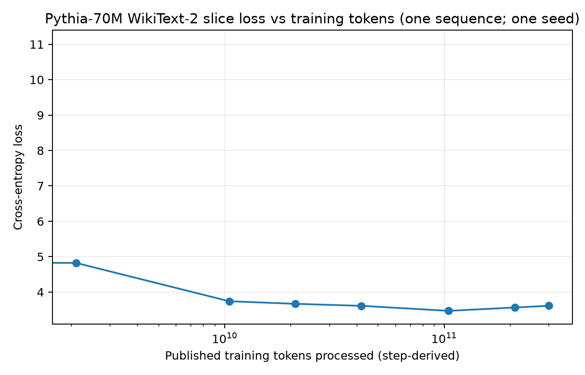

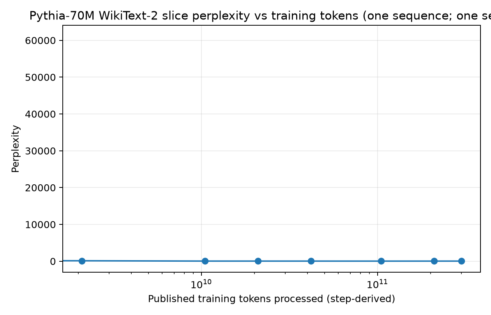

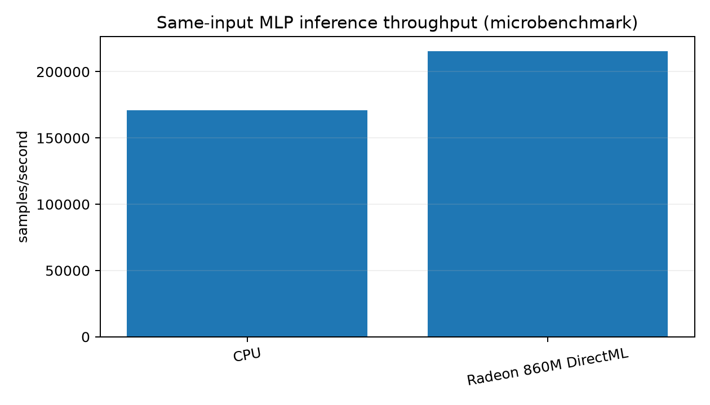

### 5.4 Compute and performance analysis

For the MLP, the epoch-1-to-2 test accuracy gain was 0.0060 (0.60 percentage points) for 0.460 seconds of additional measured training, and the epoch-2-to-3 gain was 0.0311 (3.11 points) for 0.434 seconds. Marginal efficiency was about 0.0130 and 0.0717 accuracy units per second, respectively. This short curve does not show diminishing returns. For DQN, cumulative wall time is recorded, but single-seed episodic-return changes are not a stable efficiency estimate. No pooled efficiency across paradigms is meaningful. The literature CSV retains missing compute values; Chinchilla's matched-compute design and PaLM's reported FLOPs permit limited within-paper discussion, while LLaMA's HellaSwag scores alone do not establish diminishing returns.

## 6. Planned statistical analysis

For each comparable local series, adjacent-budget change is measured on the metric's native scale and cumulative wall time is the primary practical cost axis. Mean, standard deviation, and 95% confidence intervals will be computed across aligned seeds where feasible. Marginal efficiency retains units such as accuracy points per second, loss reduction per second, or mean return per environment step. A saturation flag is preregistered as less than 1% relative improvement across two consecutive budget increments, with 0.5% and 2% sensitivity checks; it is a descriptive threshold, not a universal value judgment. Scaling-law fits will be attempted only with sufficient compatible observations and uncertainty/residual diagnostics.

## 7. Discussion and limitations

The initial literature supports a nuanced working hypothesis: more computation can improve measured language-model performance, yet allocating a fixed budget differently between parameters and tokens can change the outcome; inference cost can favor a smaller model even when training a larger model is feasible. This is not a completed answer to the study question. Local experiments are required to determine whether similar marginal patterns hold for the chosen conventional tasks.

Key limits are (1) single-seed pilots on a small image subset; (2) one budget per conventional model, below the requested schedules; (3) repeated test evaluation during some exploratory earlier curves; (4) LLM scores use one short WikiText-2 slice and have no downstream benchmark evaluation; (5) 9 LLM configurations have no local score (one failed fetch, eight resource-limited); (6) the NPU runtime is not installed, DirectML operator fallback occurs, and utilization/VRAM are not profiled; (7) literature fields and exact locators still need source-level verification; and (8) cross-paper datasets, hardware, prompts, and reporting units differ. The completion matrix and remaining-work file distinguish actual runs from incomplete work. The study does not claim to be complete.

## 8. Conclusion

The project now has saved feasibility evaluations for all 20 conventional registry entries (with the LabelSpreading and compact ViT substitutions documented), six of 15 requested LLM configurations, an eight-checkpoint Pythia-70M loss/perplexity trajectory, hardware-aware pilots on CPU and DirectML, a 15-configuration literature ledger, and figures for the observations collected. These single-seed, one-budget results are insufficient to answer the overall value question or claim saturation. The full budget/seed schedules, NPU evaluation, remaining LLM evaluations, complete source verification, and confidence intervals remain outstanding; see `FINAL_COMPLETION_MATRIX.md` and `REMAINING_WORK.md`.

## References

1. Brown et al. (2020), *Language Models are Few-Shot Learners*. https://arxiv.org/abs/2005.14165
2. Kaplan et al. (2020), *Scaling Laws for Neural Language Models*. https://arxiv.org/abs/2001.08361
3. Rae et al. (2021), *Scaling Language Models: Methods, Analysis & Insights from Training Gopher*. https://arxiv.org/abs/2112.11446
4. Hoffmann et al. (2022), *Training Compute-Optimal Large Language Models*. https://arxiv.org/abs/2203.15556
5. Chowdhery et al. (2022), *PaLM: Scaling Language Modeling with Pathways*. https://arxiv.org/abs/2204.02311
6. Zhang et al. (2022), *OPT: Open Pre-trained Transformer Language Models*. https://arxiv.org/abs/2205.01068
7. BigScience Workshop (2022), *BLOOM: A 176B-Parameter Open-Access Multilingual Language Model*. https://arxiv.org/abs/2211.05100
8. Luccioni et al. (2022), *Estimating the Carbon Footprint of BLOOM*. https://arxiv.org/abs/2211.02001
9. Touvron et al. (2023), *LLaMA: Open and Efficient Foundation Language Models*. https://arxiv.org/abs/2302.13971
10. Biderman et al. (2023), *Pythia: A Suite for Analyzing Large Language Models Across Training and Scaling*. https://arxiv.org/abs/2304.01373
